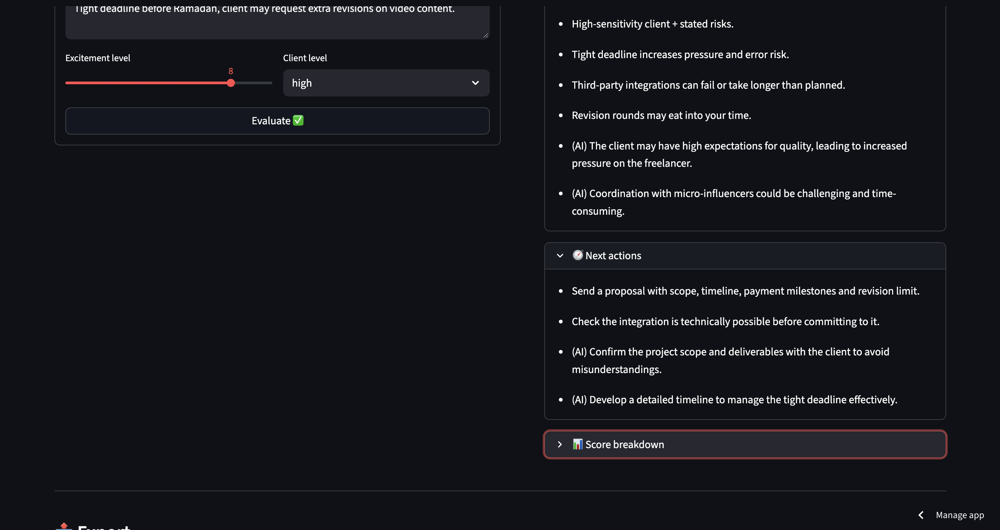
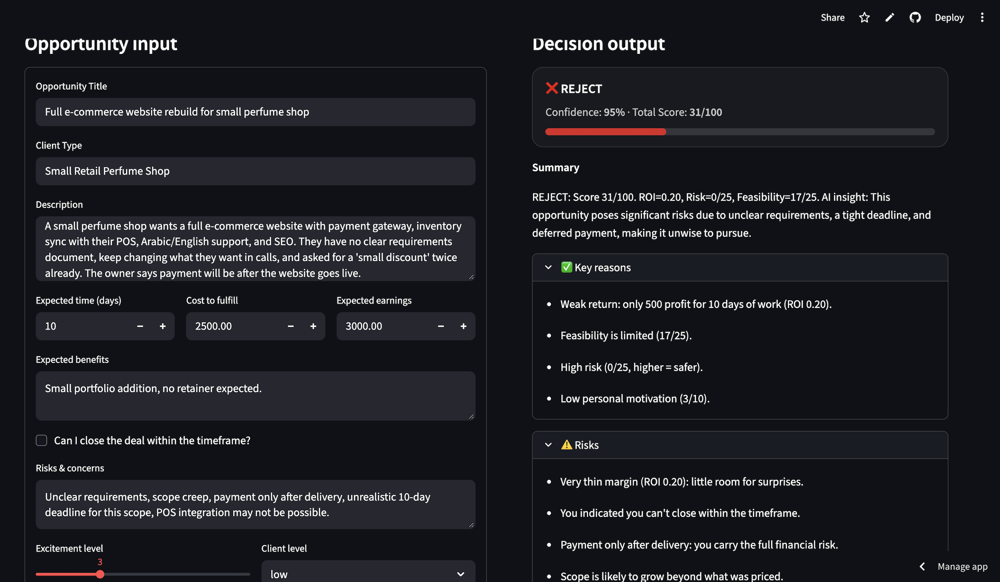

# 🧠 Decision-Making AI Agent

A hybrid decision agent that helps freelancers decide whether to **accept, reject, or ask for more information** on a client opportunity.

It combines an **explainable 100-point scoring model** (ROI, feasibility, risk, motivation) with an **optional GPT review** that adds judgement the rules can't catch. Every decision comes with reasons, risks, and concrete next steps, and is saved to a memory file that can be exported as CSV.

**🔗 Live demo:** https://decision-making-ai.streamlit.app

> Add your screenshots to the `assets/` folder and update the paths below.

| ACCEPT example | REJECT example |
|---|---|
|  |  |

---

## ✨ Features

- **Clear decision:** `ACCEPT`, `REJECT`, or `NEEDS_INFO`, with a confidence level and a total score out of 100
- **Explainable scoring:** every point comes from a visible rule (see the tables below)
- **Plain-language reasons:** strengths and weaknesses that explain *why* the decision was made
- **Risk detection:** reads both the "Risks & concerns" and "Description" fields, and explains each risk it finds
- **Specific next actions:** e.g. counter-offer price, upfront deposit, scope document, phased timeline
- **Optional GPT review:** adds an insight, risks you didn't mention, and extra next actions, marked `(AI)`
- **Memory:** every evaluation is stored in `memory/decisions.jsonl`
- **CSV export:** download all past decisions from the UI

---

## 🧮 How the score works

Total score = ROI (0–30) + Feasibility (0–25) + Risk safety (0–25) + Motivation (0–20)

### Decision rules

| Condition | Decision |
|---|---|
| ROI is negative (the deal loses money) | **REJECT**, always |
| Total score > 70 | **ACCEPT** |
| Total score < 55 | **REJECT** |
| Otherwise | **NEEDS_INFO** |

Confidence grows the further the score is from the threshold.

### ROI score (0–30)

`ROI = (earnings − cost) / cost`

| ROI | Points |
|---|---|
| ≤ 0 | 0 |
| ≤ 0.3 | 8 |
| ≤ 0.6 | 14 |
| ≤ 1.0 | 20 |
| ≤ 2.0 | 26 |
| > 2.0 | 30 |

### Feasibility score (0–25)

Based on the expected duration (≤14 days = 25, up to 22 / 20 / 16 / 10 for longer projects), minus 8 points if you can't close the deal within the timeframe.

### Risk score (0–25, higher = safer)

Starts at 20. Each risk factor found in the text subtracts points (each factor counts once), then a client-level adjustment is applied:

| Risk factor | Penalty |
|---|---|
| Payment only after delivery / no deposit | −7 |
| No or low budget | −7 |
| Legal or contract requirements, refund/chargeback exposure | −6 |
| Scope creep, unclear requirements, unrealistic timeline | −5 each |
| Security or data responsibility | −5 |
| Difficult client signs | −4 |
| Tight deadline, client pushing on price, third-party integrations, uncertainty, delays | −3 each |
| Revision rounds | −2 |

| Client level | Adjustment |
|---|---|
| low | +3 |
| normal | 0 |
| high | −7 |
| sensitive | −12 |

### Motivation score (0–20)

`excitement level (0–10) × 2`

---

## 🔍 Example results

| Opportunity | Earnings vs cost | Score | Decision |
|---|---|---|---|
| Social media launch for a luxury perfume brand | 6,000 vs 1,500 | 79 | ✅ ACCEPT |
| Full e-commerce rebuild, unclear scope, payment after delivery | 3,000 vs 2,500 | 31 | ❌ REJECT |
| Mobile app priced below cost | 2,000 vs 4,000 | 52 | ❌ REJECT (negative ROI) |

---

## 🏗️ Project structure

```
.
├── app/
│   ├── models.py      # Pydantic input/output schemas
│   ├── scoring.py     # Deterministic scoring rules
│   ├── agent.py       # Decision logic, reasons, actions, optional GPT review
│   ├── memory.py      # Saves decisions to JSONL
│   └── main.py        # Optional FastAPI backend (/health, /evaluate)
├── ui/
│   └── app.py         # Streamlit interface
├── memory/            # decisions.jsonl (created at runtime)
├── assets/            # screenshots
├── export_csv.py      # Standalone JSONL → CSV exporter
└── requirements.txt
```

**Flow:** Streamlit form → `OpportunityInput` → `score_opportunity()` → decision, reasons, risks and actions → *(optional)* GPT review → `DecisionOutput` → saved to memory and displayed.

---

## 🚀 Run locally

```bash
git clone https://github.com/ali-abdulqawi/decision-making-ai-agent.git
cd decision-making-ai-agent

python -m venv .venv
source .venv/bin/activate        # Windows: .venv\Scripts\activate
pip install -r requirements.txt

streamlit run ui/app.py
```

The Streamlit app calls the agent directly, so no separate server is needed.

**Optional FastAPI backend:**

```bash
uvicorn app.main:app --reload
# Docs at http://127.0.0.1:8000/docs
```

### Enable the GPT review (optional)

Without a key the agent works fully rule-based. To add the AI review, set an API key:

```bash
export OPENAI_API_KEY="sk-..."
export OPENAI_MODEL="gpt-4o-mini"   # optional, this is the default
```

On Streamlit Cloud, add `OPENAI_API_KEY` under **Settings → Secrets** instead. Never commit a key to the repository.

---

## 🛠️ Tech stack

Python · Streamlit · Pydantic · FastAPI · OpenAI API · pandas

---

## ⚠️ Limitations

- Risk detection is **keyword-based**, so unusual wording can be missed. The GPT review helps cover this.
- Scoring weights and thresholds are **hand-tuned**, not learned from real outcomes.
- Streamlit Cloud storage is **not permanent**, so saved decisions can reset when the app restarts. Use a database or Google Sheets for persistence.
- The GPT review is a second opinion, not part of the score, so the decision itself stays predictable and explainable.

## 🗺️ Roadmap

- Persistent storage (PostgreSQL or Google Sheets)
- Configurable weights and thresholds in the UI
- Arabic interface and Arabic risk keywords
- Compare multiple opportunities side by side

---

## 👤 Author

**Ali Abdulqawi Moqbel**: AI automation specialist and web developer
[LinkedIn](https://www.linkedin.com/in/ali-abdulqawi-398387195/) · [GitHub](https://github.com/ali-abdulqawi)
